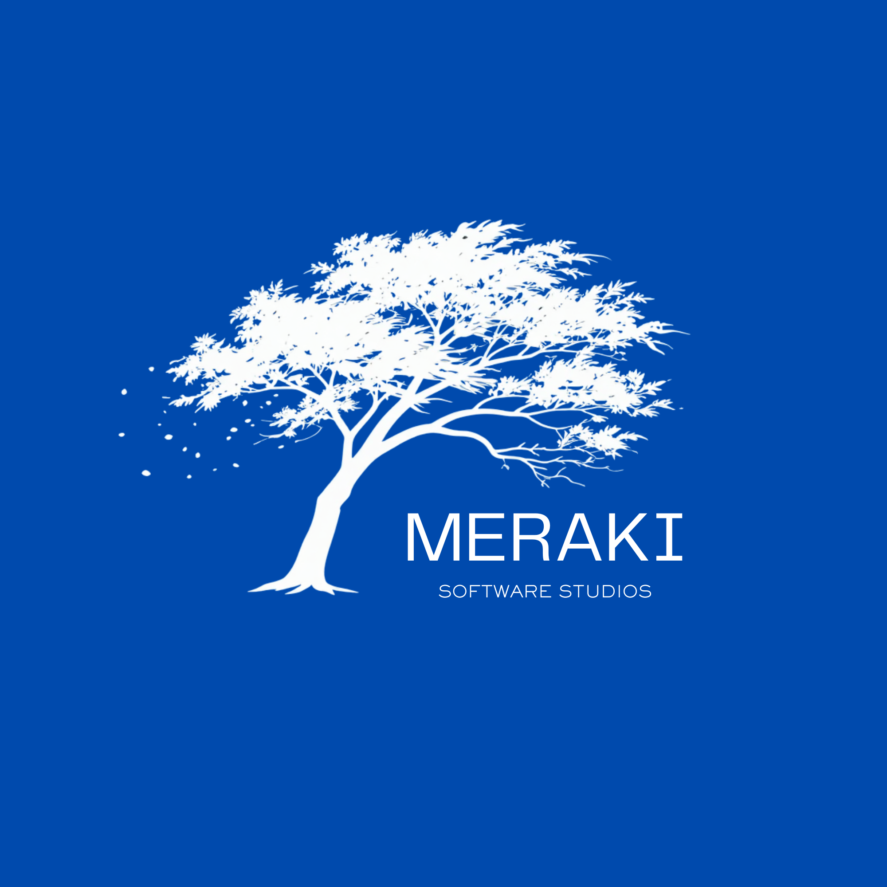

<h1>
  
  EcoWayer — Termo de Abertura do Projeto (TAP)
</h1>

 

> **TCC** — SENAI Jandira | Curso Técnico em Desenvolvimento de Sistemas  
> **Empresa:** EcoWayer

---

## 1. Identificação do Projeto

| Campo | Informação |
| :--- | :--- |
| **Nome do Projeto** | EcoWayer |
| **Empresa / Equipe** | Meraki |
| **Curso** | Técnico em Desenvolvimento de Sistemas |
| **Instituição** | SENAI Jandira |
| **Data de Início** | 10/08/2026 |
| **Data de Entrega** | 04/12/2026 |

---

## 2. Descrição do Projeto

O **EcoWayer** é uma plataforma focada em sustentabilidade e economia circular que conecta pessoas e empresas para facilitar o descarte e reaproveitamento de materiais.

No aplicativo, os usuários encontram pontos de coleta seletiva e negociam itens recicláveis ou reutilizáveis por meio de doações, trocas ou vendas, com chat em tempo real moderado por inteligência artificial.

Para incentivar o uso frequente, a plataforma conta com um sistema de recompensas que troca ações ecológicas por pontos que viram cupons de desconto em parceiros.

### Alinhamento com os Objetivos de Desenvolvimento Sustentável (ODS)

- **ODS 12 — Consumo e Produção Responsáveis (Meta 12.5):** Redução da geração de resíduos pelo incentivo prático à reciclagem e reutilização.
- **ODS 11 — Cidades e Comunidades Sustentáveis:** Apoio à destinação correta de resíduos sólidos nas cidades.

---

## 3. Vídeo de Apresentação — Pitch EcoWayer

Conheça a proposta da **EcoWayer** e descubra como a tecnologia pode transformar o descarte de materiais em oportunidades de reutilização e sustentabilidade.

**Assista ao nosso Pitch:**

[Clique aqui para assistir ao Pitch da EcoWayer](https://youtu.be/dRs0VsSeSCE)

---

## 4. Tecnologias Utilizadas

O projeto **EcoWayer** utiliza diferentes tecnologias para o desenvolvimento das aplicações web, mobile, API e persistência de dados.

### Front-End Web

### Back-End / API

### Desenvolvimento Mobile

### Banco de Dados

---

## 5. Equipe de Desenvolvimento

| Integrante | Responsabilidade |
| :--- | :--- |
| [Jean Costa](https://github.com/Jean090504) | Desenvolvedor Back-End / Mobile / Gestor de Projetos |
| [Maxwillian Santana](https://www.linkedin.com/in/maxw06/) | Desenvolvedor Back-End / Mobile |
| [Fernanda Cardoso](https://www.linkedin.com/in/fernanda-mota-38435b37a/) | Administradora de Banco de Dados |
| [Aryely Hevylyn](https://www.linkedin.com/in/aryely-hevylyn-ab9a3039a/) | Desenvolvedora Front-End / Analista de Requisitos |
| [Gustavo Vitor](https://www.linkedin.com/in/gustavo-souza08/) | Administrador de Banco de Dados |

---

## 6. Links do Projeto

| Recurso | Link |
| :--- | :--- |
| Documentação do Projeto | [Acessar Documentação](https://drive.google.com/drive/folders/1FeubhHVvDEJGcV2y63dFbaCoqymqb3d4) |
| Protótipos (Figma) | [Acessar Protótipos](https://www.figma.com/design/JWe7ZSc4GvvOtADTrDhuNe/EcoWayer---TCC?node-id=175-2&t=MuRQZsqDPGva6A0u-1) |
| WBS / Estrutura Analítica | [Acessar WBS](https://miro.com/app/board/uXjVHpR-YIM=/?share_link_id=475833631340) |
| Planejamento de Tarefas | [Acessar Planejamento](https://docs.google.com/spreadsheets/d/1HC-Cw-OUzVDbk_k5hwUcMqXAJ_WQQ-HHmuMfLBYcfXc/edit?gid=1709744959#gid=1709744959) |
| Front-End | [Repositório GitHub](https://github.com/Jean090504/EcoWayer_Front-end) |
| Back-End | [Repositório GitHub](https://github.com/Jean090504/EcoWayer_Back-end) |
| Mobile | [Repositório GitHub](https://github.com/Jean090504/EcoWayer_Mobile) |
| Vídeo Pitch | [Assistir no YouTube](https://youtu.be/dRs0VsSeSCE) |

---

  <strong>EcoWayer — Tecnologia para um futuro mais sustentável.</strong>

  
Desenvolvido pela equipe Meraki | SENAI Jandira — 2026

